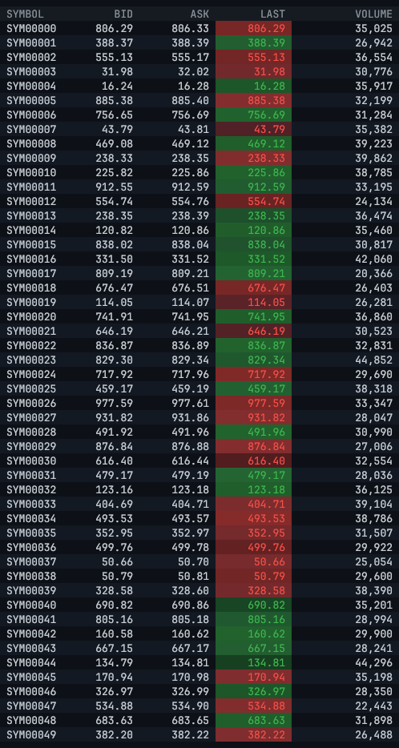
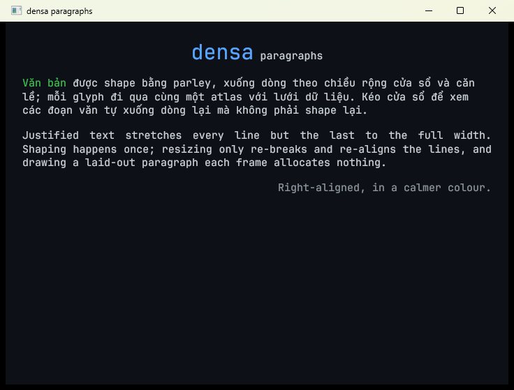

# densa

Low-latency data and UI infrastructure in Rust for data-dense applications: trading
terminals, order books, live dashboards. Long-term goal: a Qt-like application framework.

> **Status: proof of concept.** Tested on Windows 11 only. Homepage: <https://densa.dev>.



The PoC proves two properties end to end, with measurements rather than claims:

- **Zero-lock ingestion.** A worker thread applies a synthetic feed of 200,000+ ticks/s to a
  10,000-instrument table and hands the visible rows to the render thread through a wait-free
  triple buffer. Neither thread ever blocks on the other.
- **Zero-allocation frames.** After startup, the worker loop and the per-frame grid building
  perform no heap operations at all, verified by a counting global allocator on every run.

## Results

Intel i7-14700KF (8 P-cores + 12 E-cores), RTX 4060 Ti (Vulkan), 1920x1080 @ 99 Hz,
Windows 11, release build, 10,000 symbols, worker pinned to a P-core at time-critical
priority (the defaults). Numbers are from the summary line each run prints.

| Run | Throughput | Frames | Snapshot age p50 / p99 | Heap ops after startup |
|---|---|---|---|---|
| Window, 200k ticks/s target, V-Sync | 200.0k ticks/s | 99.8 fps (display rate) | 164 us / 328 us | worker 0, paint 0 |
| Headless, 200k ticks/s target | 200.0k ticks/s | 120.0 fps | 156 us / 328 us | worker 0, frame loop 0 |
| Headless, unbounded, batch 1024 | 115.3M ticks/s | 120.0 fps | 47 us / 107 us | worker 0, frame loop 0 |

Building a frame's 50 rows of instances (`GridPainter::paint`) takes ~35 us (p50) and ~65 us
(p99) with real text (JetBrains Mono 13px, two cache lookups per glyph); the 8x8 bitmap font it
replaced took ~19 us. That is on a P-core: the render thread is not pinned, and when Windows
schedules it on an E-core the same work takes ~70 us (p50). wgpu itself allocates during submit/present (~199 heap operations per
frame); that is measured and reported separately, not hidden.

Micro-benchmarks (criterion, bench thread pinned to a P-core): triple buffer publish 4.4 ns,
update + read 10.6 ns, 2.8 KB fill + publish with a reader spinning on another core 72 ns;
`snapshot_into` (50 rows) 51 ns.

## Quick start

Requirements: Rust 1.90+, a GPU with Vulkan, DX12 or Metal for the window.

```sh
cargo run --release -p densa-poc                         # window (default)
cargo run --release -p densa-poc -- --headless           # no window, prints metrics
cargo run --release -p densa-poc -- --headless --unbounded --batch 1024
cargo run --release -p densa-poc -- --list-cpus          # CPU topology and --pin choice
cargo run --release -p densa-poc -- --help
```

Window controls: mouse wheel, Up/Down, PageUp/PageDown, Home/End scroll; Esc quits.

| Option | Default | Meaning |
|---|---|---|
| `--headless` | off | Run the same frame loop without a window |
| `--seconds N` | 10 headless, until closed in a window | Run time |
| `--rate N` / `--unbounded` | 200000 | Target ticks per second, or as fast as possible |
| `--symbols N` | 10000 | Number of instruments |
| `--batch N` | 64 | Ticks per worker iteration |
| `--publish-interval-us N` | 100 | Minimum time between snapshot publishes |
| `--fps N` | 120 | Frame rate of the headless loop |
| `--pin auto\|none\|N` | auto | Worker placement (see below) |
| `--priority normal\|above\|high\|critical` | critical | Worker thread priority (see below) |
| `--seed N` | 1 | Seed of the synthetic feed |

### Reading the metrics

Every second a line like this is printed (and the window title shows a summary):

```text
[  3s] 100 fps | paint p50 17.4us p99 45.1us | frame interval p50 10.49ms ... | snapshot age p50 155.6us p99 816.7us ...
```

- **snapshot age**: time from the worker publishing a snapshot to a frame displaying it. This
  is the pipeline latency. In rate-limited mode it is bounded by the batch interval (64 ticks at
  200k/s = 320 us); a smaller `--batch` lowers it.
- **tick age**: time since the newest tick among the visible rows. This measures how *fresh*
  the data is, not the pipeline: each of 10,000 symbols updates only ~20 times per second.
- **heap ops**: heap operations since startup, per thread. The worker and the frame painting
  must stay at 0. "gpu submit" is wgpu's internal work.
- **pacer resets**: times the worker fell over 10 ms behind schedule and restarted it, i.e. it
  was preempted. **migrations**: times the OS moved the worker to another CPU.

## Architecture

```text
 worker thread (pinned P-core)                      render thread (main)
 ┌──────────────────────────────┐                   ┌─────────────────────────────┐
 │ TickGenerator  ─▶ MarketTable │   triple buffer   │ Reader::update / read       │
 │  (wyrand walk)     (AoS rows) │ ─────────────────▶│ FrameProbe (latency)        │
 │        snapshot_into(viewport)│  50-row snapshot  │ GridPainter ─▶ Instances    │
 │        Writer::publish        │◀──── viewport ────│ GpuGrid: 1 instanced draw   │
 └──────────────────────────────┘   (AtomicU32 hint) └─────────────────────────────┘
```

| Crate | Role |
|---|---|
| `densa-sync` | Wait-free SPSC triple buffer, loom-checked |
| `densa-data` | `MarketTable`, `TickGenerator`, fixed-size `ViewportSnapshot<N>` |
| `densa-fmt` | Allocation-free number formatting into stack buffers |
| `densa-alloc` | Per-thread counting allocator that proves zero-allocation claims |
| `densa-platform` | CPU topology, thread pinning, process-wide CPU claim registry (the only FFI) |
| `densa-engine` | Ingestion worker, pacer, latency histogram, frame probe |
| `densa-text` | Fonts, glyph rasterization and an allocation-free glyph atlas cache |
| `densa-paragraph` | Paragraph layout (parley): shaping, wrapping, bidi, alignment, styled spans |
| `densa-render` | Domain-agnostic grid: `GridSource` trait, `GridPainter` (GPU-free, unit-tested), `GpuGrid` (wgpu 30) |
| `densa-poc` | The demo binary: market columns (`MarketGrid`), argument parsing, window and headless modes |
| `densa-bench` | Criterion benchmarks, kept out of the libraries' dependencies |

Dependencies only point downward (app → render → text/fmt, app → engine → data/sync); core
crates never depend on GPU or windowing crates, and the renderer knows nothing about markets.

### Paragraphs

`densa-paragraph` shapes, wraps and aligns text with [parley](https://github.com/linebender/parley)
and draws it through the same glyph atlas as the grid. Resizing re-breaks lines without
reshaping; drawing a laid-out paragraph allocates nothing.



```text
cargo run --release -p densa-paragraph --example paragraphs
```

### Design decisions, and the evidence behind them

- **Both triple-buffer swaps use `AcqRel`.** "Release on publish, Acquire on fetch" is unsound:
  it misses the write-after-read edge when the writer reuses a slot the reader just released.
  `scripts/ordering_mutants.ps1` weakens each ordering and checks that loom reports a causality
  violation for every weaker variant.
- **Snapshots carry only the visible viewport.** The worker keeps the whole table privately and
  publishes 50 rows (~3 KB); the render thread tells it which rows through an atomic hint.
  Copying the full table per publish would be ~480 KB.
- **Array-of-structs, not structure-of-arrays.** Each tick updates one random row: one or two
  cache lines in AoS, one per column (seven) in SoA. Pinned benchmarks at 1M symbols: 39M ticks/s
  vs 23M for SoA; equal when the table fits in cache.
- **Pin the worker to a performance core.** On this hybrid CPU an unpinned busy-spinning worker
  migrated 446-4,442 times per 5 s and ran at 30-55M ticks/s whenever it landed on an E-core,
  versus 105-116M pinned to a P-core. A process-wide registry gives every auto-pinned worker its
  own physical core.
- **Pinned *and* time-critical.** Pinning decides where the worker runs, not who wins the
  core: next to a busy normal-priority process pinned to the same core
  (`scripts/priority_experiment.ps1`), a normal-priority worker reached 100.8k of 200k ticks/s
  with snapshot age p99 32.5 ms; `above`/`high` only reached ~170k with p99 ~30 ms; only
  `critical` held 198k with p99 under 1 ms. The demo defaults to it (`--priority normal` opts
  out); the library default stays `Normal`.
- **One draw call.** Every quad is a solid rectangle or a glyph from a coverage atlas, drawn
  as instances. Glyphs are rasterized on first use (4 subpixel positions) and uploaded once;
  the demo rasterizes its whole character set at startup, so frames never allocate. Building
  instances is GPU-free code with unit tests; the GPU half is verified by rendering offscreen
  and reading pixels back.
- **The renderer is generic.** Apps describe columns and implement `GridSource`, formatting
  each cell into a stack buffer; markets, prices and flashes live in the demo, not the renderer.
- **Only the LAST cell flashes, for 300 ms.** With each symbol changing ~20 times per second, a
  first version that flashed whole rows for 600 ms turned the grid into a wall of color.

## Verification

```sh
cargo test --workspace                       # includes GPU readback and a 2 s window run
cargo clippy --workspace --all-targets -- -D warnings
RUSTFLAGS="--cfg loom" cargo test -p densa-sync --release --test loom_triple_buffer
cargo +nightly miri test --target x86_64-unknown-linux-gnu -p densa-sync -p densa-alloc -p densa-platform
cargo llvm-cov --workspace --summary-only    # ~96% of lines
cargo +1.90 check --workspace --all-targets  # MSRV
cargo bench -p densa-bench
powershell -File scripts/ordering_mutants.ps1
powershell -File scripts/pinning_experiment.ps1
powershell -File scripts/priority_experiment.ps1
```

Set `DENSA_SKIP_GPU_TESTS=1` on machines without a GPU or desktop session.

Miri runs against the Linux target on purpose: with a custom global allocator it executes the
real Windows `System` allocator, whose over-aligned path reports UB under Miri even with a plain
`static GLOBAL: System = System;`. Miri cannot model the Windows FFI in `densa-platform`; those
calls are covered by tests that watch threads actually move between CPUs.

## Limitations

- **No core isolation.** A time-critical pinned worker mostly wins its core, but next to a
  busy neighbor it still stalled about twice per 6 s (max ~30 ms), plausibly Windows' boosting
  of starved threads to the same priority. Reserving a core (Windows CPU Sets for the other
  processes, `isolcpus` on Linux) is the remaining step.
- **CPU pinning is Windows-only**; elsewhere `--pin auto` runs unpinned and says so.
- **The CPU claim registry is per process**: two densa processes may still pick the same core.
- **Grid cells are unshaped, single-line text** (one glyph per character, `?` for missing
  ones); characters outside the prewarmed set allocate once, the first time they are drawn.
  Paragraphs (`densa-paragraph`) are shaped, wrapped and bidi-ordered, but by default use only
  the bundled font (no fallback: CJK shows missing-glyph boxes; the `system-fonts` feature adds
  the OS fonts). Not yet: inline boxes, variable-font axes, synthetic bold/italic, color emoji,
  hit-testing and editing.
- **The glyph atlas is bounded** (by default four 1024 x 1024 pages, 4 MiB, capped to the GPU's
  texture limit). It grows a page at a time, then evicts the least recently used glyphs. If a
  single frame needs more glyphs than the whole atlas holds, the extra ones are skipped that
  frame (counted) and placed in a later frame; glyphs larger than a page are never drawn.
- **The feed is synthetic.** No network ingestion, order book or persistence yet.
- wgpu allocates per frame internally; "zero-allocation frames" covers densa's own code.

## License

Licensed under either of

- Apache License, Version 2.0 ([LICENSE-APACHE](LICENSE-APACHE))
- MIT license ([LICENSE-MIT](LICENSE-MIT))

at your option.

Unless you explicitly state otherwise, any contribution intentionally submitted for inclusion
in this work by you, as defined in the Apache-2.0 license, shall be dual licensed as above,
without any additional terms or conditions.

The bundled font `crates/densa-text/fonts/JetBrainsMono-Regular.ttf` (JetBrains Mono 2.304)
is licensed separately under the SIL Open Font License 1.1; see
[crates/densa-text/fonts/OFL.txt](crates/densa-text/fonts/OFL.txt).
